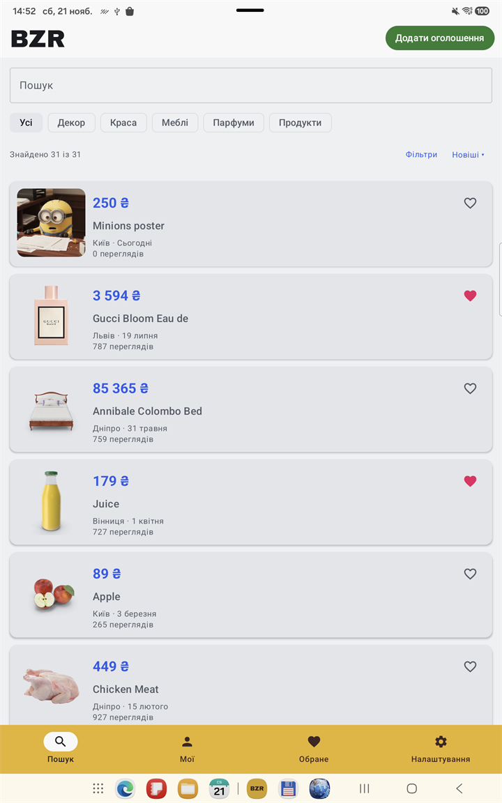
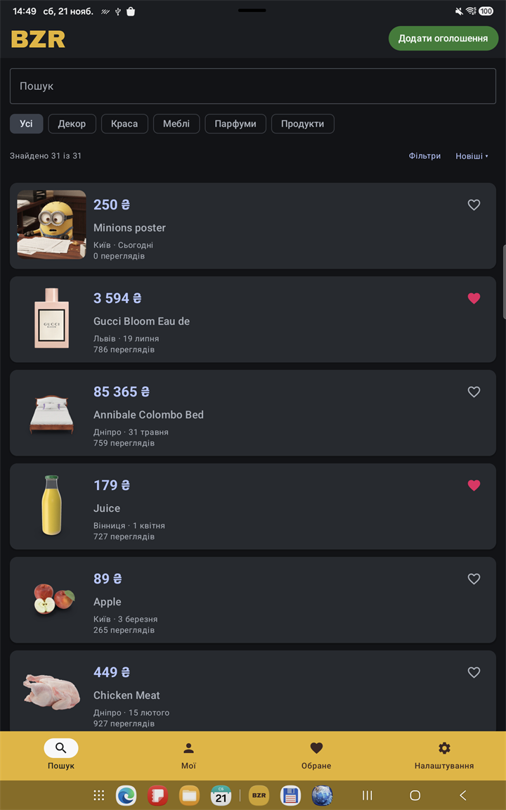
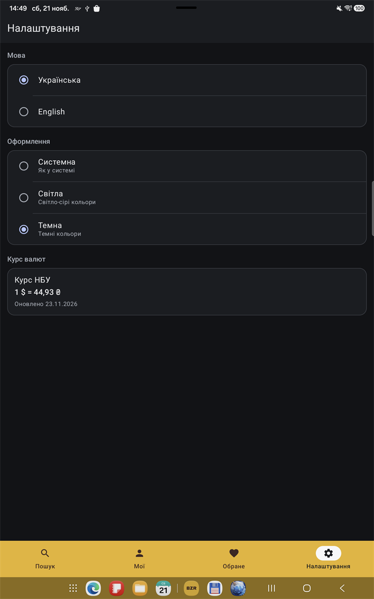
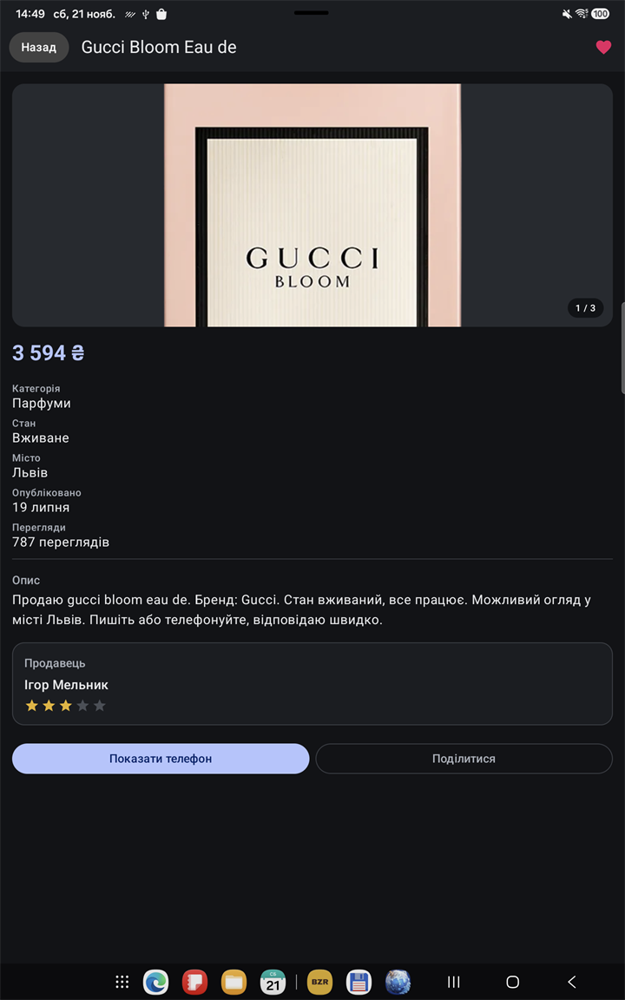
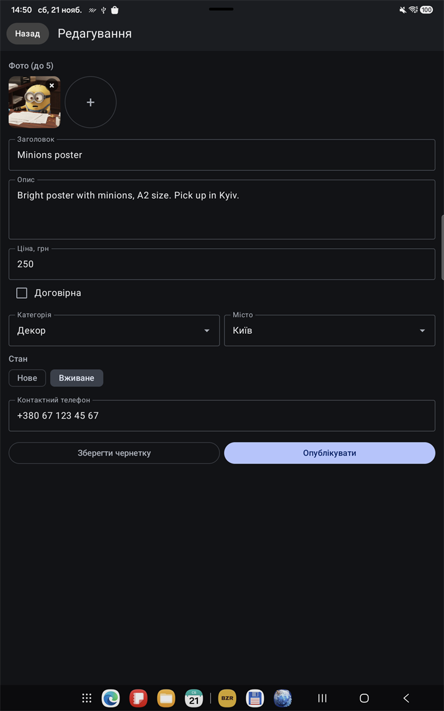
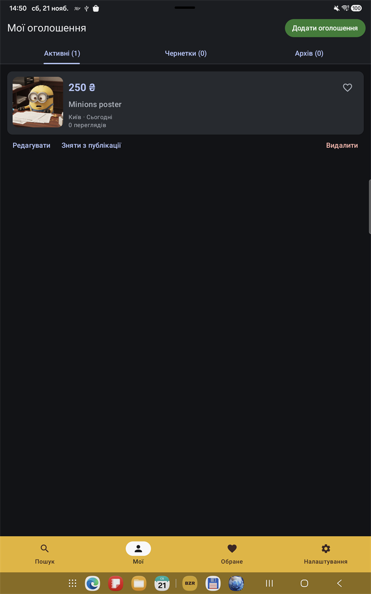
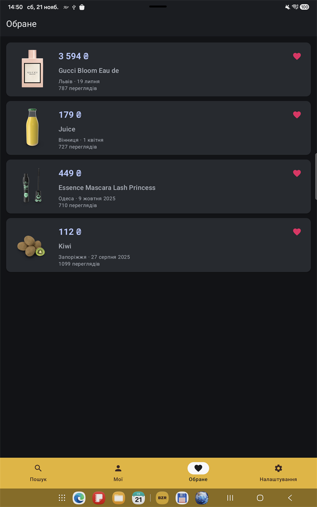
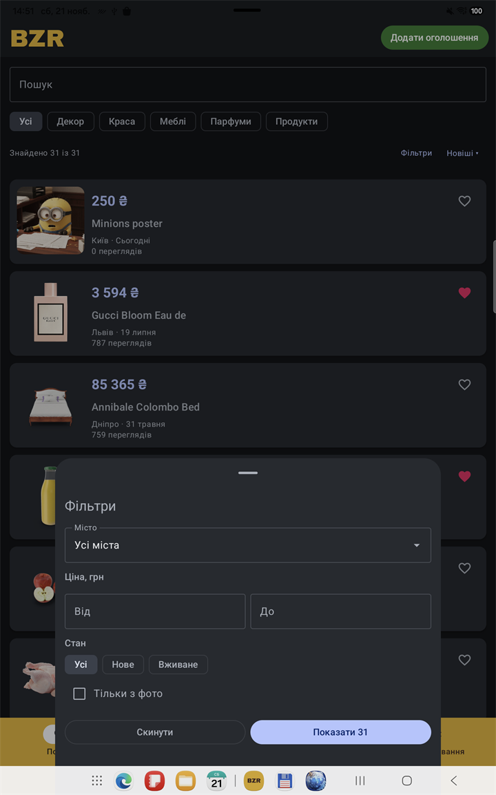
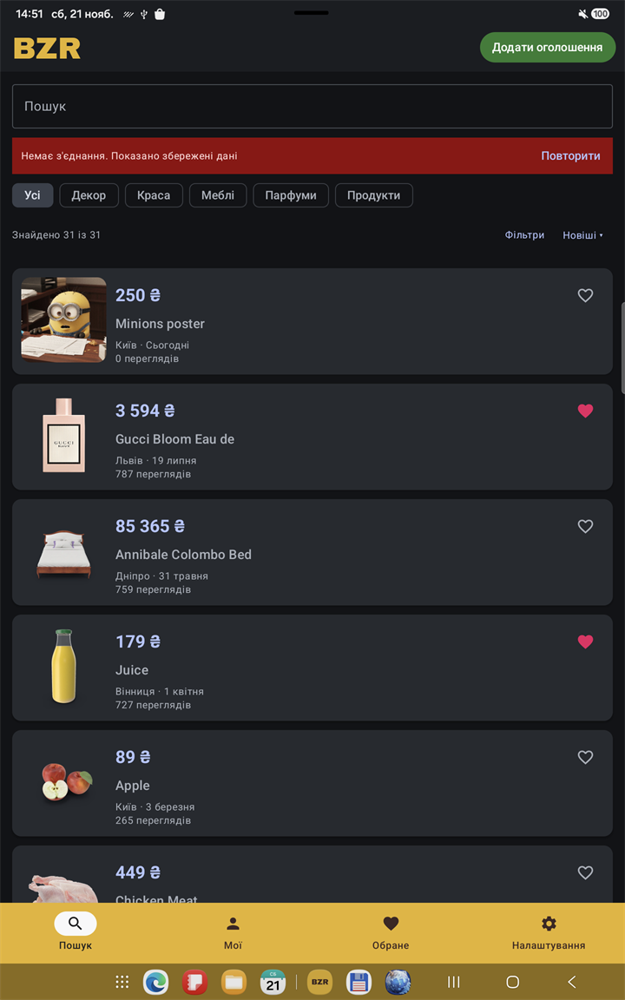

<p align="center">
  
</p>

BZR is an OLX-style classified ads app for Android, written in Kotlin with Jetpack Compose.
It combines a demo remote feed with ads created locally on the device and works offline,
because Room is the single source of truth.

## Screenshots

<p align="center">
  
  
  
</p>
<p align="center"><sub>Light theme · Dark theme · Settings</sub></p>

<p align="center">
  
  
  
</p>
<p align="center"><sub>Ad details · Ad form · My ads</sub></p>

<p align="center">
  
  
  
</p>
<p align="center"><sub>Favorites · Filters · Offline mode</sub></p>

## Features

- Ad feed with photos, price in hryvnia, title, city, publish date and view counter.
- Search by title, description, city and category, with a clear action and keyboard search.
- Category chips, sorting (newest, cheapest, most expensive) and filters:
  city, price range, condition, "photos only"; filters can be reset from the sheet
  or from the empty state.
- The feed is split into pages of ten; the page bar appears after the last ad
  and only when the list has more than ten ads.
- Pull to refresh reloads the feed; the offline banner keeps cached ads on screen.
- Demo prices are converted from USD with the official NBU rate, loaded on every sync.
  The rate and its date are shown in Settings.
- Ad details with a swipeable photo gallery, a full screen viewer for every photo,
  description, seller block with a star rating, phone reveal, share sheet,
  favorite toggle and view counter.
- Creating and editing ads: up to 5 photos from the gallery, validation,
  draft and publish actions; duplicate submits are blocked and unsaved changes are confirmed.
- Phone numbers are entered and displayed as `+380 XX XXX XX XX`.
- "My ads" with Active, Drafts and Archive tabs; publish, archive and delete actions.
- Favorites.
- Offline-first: the cached list stays available, a banner explains the missing connection,
  and user ads are never overwritten by a network refresh.
- Views grow once per visit; ads created on the device are not counted.
- Light and dark themes with a System / Light / Dark switch in Settings, saved between launches.
- Ukrainian and English interface with a language switch in Settings; categories and cities
  are stored as language-neutral keys and translated on the screen.
- Dependency injection with Koin.

## Tech stack

| Area | Library |
| --- | --- |
| UI | Jetpack Compose, Material 3 |
| Presentation | ViewModel, StateFlow, UiState, Koin ViewModel DSL |
| Architecture | Clean Architecture: UI, domain, data |
| Local storage | Room (KSP) |
| Network | Retrofit, OkHttp, kotlinx.serialization |
| Images | Coil 3 |
| Branding | Archivo Black (SIL OFL), wordmark in `docs/logo` |
| DI | Koin |
| Tests | JUnit 4, kotlinx-coroutines-test, Compose UI Test, AndroidX Test, Room in-memory |

## Architecture

```
Compose screen
    ↓ events
ViewModel (StateFlow<UiState>)
    ↓
Use cases
    ↓
AdRepository (interface)
    ↓
AdRepositoryImpl
    ├── Room (cache, source of truth)
    └── Retrofit API (demo feed, refreshes the cache)
```

- `ui` contains screens, ViewModels, UiState and UI-only models.
- `domain` contains the repository contract and use cases.
- `data` contains Room entities and DAO, Retrofit API and DTOs, mappers, the repository
  and the theme settings storage.
- `di` contains Koin modules: network, database, settings, repository, use cases, ViewModels.

### Local and remote ads

`ads` stores both kinds in one table, separated by the `source` column:

- remote ads keep positive IDs from the demo API;
- user ads get negative IDs (`-1`, `-2`, ...), so they never clash with the network feed;
- `ad_images` stores photos for both kinds, one row per photo.

`refresh()` replaces only `source = 'REMOTE'` rows. Before deleting them, it reads the current
`views` and `isFavorite` values and restores them on the new rows, so user actions survive sync.

## Project structure

```
app/src/main/java/com/example/adboardapp
├── data
│   ├── local        Room entities, DAO, database
│   ├── mapper       DTO and entity mappers
│   ├── remote       Retrofit API and DTOs
│   ├── settings     theme and language preferences
│   └── AdRepositoryImpl.kt
├── di               Koin modules
├── domain           repository contract and use cases
├── model            domain models and enums
└── ui               Compose screens, ViewModels and state
```

## Getting started

Requirements:

- Android Studio with JDK 17 or newer (the bundled JBR works);
- Android SDK 37 and a device or emulator running Android 8.0 (API 26) or newer.

Build and install the debug APK:

```powershell
.\gradlew.bat :app:assembleDebug
.\gradlew.bat :app:installDebug
```

The demo feed uses [dummyjson.com](https://dummyjson.com/products). No API key is required.

## Tests

Unit tests (JVM):

```powershell
.\gradlew.bat :app:testDebugUnitTest
```

Instrumented tests (need a connected device or emulator):

```powershell
.\gradlew.bat :app:connectedDebugAndroidTest
```

Coverage:

- `AdMappersTest` — DTO/entity/domain mapping, photo order, price conversion with a rate,
  real creation date, average seller rating;
- `ListUiStateTest` — search, category, city, price, condition, photo filter, sorting
  and pages of ten;
- `AdRepositoryImplTest` — refresh success and failure, local IDs, favorites, status changes,
  NBU rate and its fallbacks;
- `ListViewModelTest` — initial load, draft filtering, search, sync error, favorite action,
  pull-to-refresh indicator, page reset on search;
- `DetailViewModelTest` — one view per visit, own ads are not counted, missing ad state;
- `RatingStarsTest` — rounding of the seller rating to whole stars;
- `PhoneFormatTest` — full, local and partly typed phone numbers;
- `AdDaoTest` — refresh keeps favorites and views, local ads survive sync, cascade delete;
- `AdListContentTest` — list rendering, search filtering and category chip callback.

The suite currently contains 46 unit tests and 6 instrumented tests.

## Release build

The release build is signed with a local keystore. Signing data is not committed:

```properties
# keystore.properties
storeFile=keystore/adboard-release.jks
storePassword=your-store-password
keyAlias=your-key-alias
keyPassword=your-key-password
```

Create the keystore once:

```powershell
keytool -genkeypair -v -keystore keystore/adboard-release.jks -alias adboard `
  -keyalg RSA -keysize 2048 -validity 10000
```

Then build:

```powershell
.\gradlew.bat :app:assembleRelease
```

The signed APK is written to `app/build/outputs/apk/release/app-release.apk`.
If `keystore.properties` is missing, the release build stays unsigned, while debug builds keep working.

Minification is disabled, so the release APK behaves exactly like the debug build.

## Limitations

- The remote feed is a demo product catalog, not a real classifieds service;
  prices are converted from USD with the NBU rate, while sellers, phones and locations
  are generated.
- User ads exist only on the device that created them. There is no backend, so ads are not
  shared between users.
- No authentication, chat, moderation, paid promotion or map.
- The network feed itself has no server pagination: one request loads 30 items, and the app
  pages the cached list by ten.
